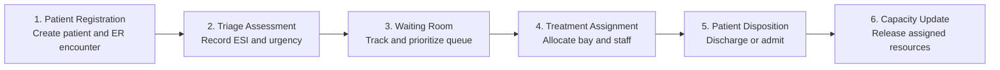

<div align="center">

# TriFlow ER Triage

### Emergency Triage & Patient Flow Management System

[](https://reactnative.dev/)
[](https://expo.dev/)
[](https://www.typescriptlang.org/)
[](https://fastify.dev/)
[](https://sqlite.org/)
[](https://nodejs.org/)

[Overview](#overview) ·
[Workflow](#the-er-workflow) ·
[Quick Start](#quick-start) ·
[User Guide](#station--module-guide) ·
[Device Setup](#shared-device--network-setup) ·
[Database](#database--operating-modes) ·
[API](#api-reference) ·
[Testing](#verification--load-testing)

</div>

---

## Overview

**TriFlow ER Triage** is an emergency department workflow application for managing patient registration, triage, waiting queues, treatment bay capacity, staff assignments, resources, and patient disposition.

The application supports a **shared API mode** for coordinated work across clients and a separate **local simulation mode** for development, demonstration, and testing.

Its primary workflows include:

- **Registration staff** create patient identities and ER encounters.
- **Clinical staff** record Emergency Severity Index (ESI) assessments, prioritize queues, assign treatment bays and staff, and record discharge or admission.
- **Administrators** manage patients, bays, staff, resources, and operational audit records.
- **Viewers** access a limited operational overview and queue information.

> **Clinical use notice:** TriFlow's documented development configuration is not a production-ready clinical deployment. Real patient data requires production authentication, transport security, institutional policies, validation, monitoring, backups, and appropriate clinical oversight. Simulation-generated recommendations and progress indicators must not guide real patient care.

---

## The ER Workflow



In **shared mode**, these steps are carried out through explicit user actions and real timestamps. Patient registration deliberately **does not assign an ESI**; triage is a separate clinical step. A discharge or admission releases the encounter's active bay and staff assignments together.

---

## Technology Stack

| Layer | Technology | Purpose |
| :--- | :--- | :--- |
| Client | React Native, Expo, TypeScript | Android, iOS, and web application |
| Navigation | React Navigation | Stack, tab, and route navigation |
| API | Fastify, TypeScript, Node.js 24+ | Shared application services and HTTP endpoints |
| Shared storage | Node.js built-in SQLite driver | Central database accessed only through the API |
| Local development storage | Expo SQLite | Per-device or per-browser simulation data |
| API documentation | OpenAPI | Generated API contract at `/openapi.json` |
| Load testing | Grafana k6 | Synthetic read/write and contention tests |

For backend implementation details, see [`server/README.md`](server/README.md).

---

## Quick Start

### Prerequisites

- **Node.js 24 or later** for the API and database tests.
- **npm** for dependency installation and commands.
- **PowerShell** for the commands below (the project can also be developed using compatible shells).
- A supported browser for Expo web, or an Android/iOS development environment for native builds.
- An **Expo development build** for the configured native client; the project is not set up to run directly in Expo Go.

### 1. Start the backend API

From the repository root, open **Terminal 1**:

```powershell
cd server
npm ci
npm start
```

The API applies migrations and creates its SQLite database at `server/data/triflow.sqlite` by default. In local development, the included development authentication adapter uses an administrator identity.

Check the server in another terminal:

```powershell
Invoke-RestMethod http://127.0.0.1:3000/health
Invoke-RestMethod http://127.0.0.1:3000/ready
```

- `/health` checks process liveness.
- `/ready` checks database connectivity and the migration ledger.

### 2. Start the Expo client

From the **repository root**, open **Terminal 2**:

```powershell
npm ci
npm run web
```

Open **http://localhost:8081**. In the documented local development configuration, the web client uses **http://127.0.0.1:3000** as its API.

## Shared Device & Network Setup

In **shared API mode**, all connected clients read and write through a single Fastify API, which owns the shared SQLite database. This differs from local Expo SQLite, where each device or browser profile has separate data.

```text
                       [ Hospital / Test Network ]
                                  |
                    +-------------+-------------+
                    |                           |
              [ API Host ]               [ Client Devices ]
            Fastify + SQLite          Registration / Clinical /
            HTTP API :3000            Administration / Viewer
                    |                           |
          server/data/triflow.sqlite     Access the reachable API
```

To connect a second device or use a different API port:

1. Configure the API's `HOST` and `PORT` to listen on the intended interface; the default `127.0.0.1:3000` is reachable only from the host computer.
2. Set `EXPO_PUBLIC_TRIFLOW_API_URL` in the client to the API URL reachable by that device.
3. For browser clients, set `CORS_ORIGINS` to the **exact** allowed frontend origins.
4. Use appropriate firewall rules, **HTTPS**, and a real production authentication adapter before sharing access beyond the host's local development environment.
5. Verify `/health`, `/ready`, and a role-authorized workflow from the intended client network.

**Connectivity behavior:** The Expo client polls the shared dashboard approximately every three seconds. If the API connection fails, the client displays an error and retry action; refresh pauses, and the API remains the source of record. **No offline synchronization is implemented.**

> **Not a one-click LAN launcher:** The provided TriFlow documentation does not describe a `run.bat`, automatic IP detection, or a bundled Windows service. Those StudioFlow features have **not** been assumed to exist in TriFlow.

### Development roles

In local simulation mode, the development role defaults to `admin`. Set `EXPO_PUBLIC_TRIFLOW_ROLE` to `registration`, `clinical`, or `viewer` to test client route and service authorization. This role override is a **development-only adapter** and does not secure a real deployment.

The shared API's development adapter includes local administrator access and optional `DEV_TOKENS` for role testing. It is **not allowed to start in production**.

### Production requirements

Before using real patient information:

- Set `NODE_ENV=production` and supply `AUTH_ADAPTER` as an absolute path to an ES module exporting `authenticate` (see `server/src/auth.ts`).
- Verify credentials server-side and map them to a stable actor ID and authorized role. Client-provided roles never grant access.
- Enforce permissions at API/service level, not merely through hidden screens.
- Serve the app and API behind **HTTPS**, restrict API origins, and keep SQLite files accessible only to the API account.
- Configure site-appropriate monitoring, rate limits, backups, retention, and clinical safety procedures.
- Use an institutional identity provider and approved access policies before processing real patient data.

### Endpoints

All routes below are relative to `/api/v1`.

| Area | Endpoints |
| :--- | :--- |
| **Identity & Overview** | `GET /me`, `GET /dashboard`, `GET /events` |
| **Patients** | `GET/POST /patients`, `GET/PATCH /patients/{patientId}`, `GET/POST /patients/{patientId}/encounters` |
| **Encounters** | `GET /encounters/{encounterId}`; `POST /encounters/{encounterId}/triage`, `/bay-assignment`, `/staff-assignments`, `/discharge` |
| **Queues** | `GET /queues`, `PATCH /queues/{queueId}` |
| **Treatment Bays** | `GET/POST /treatment-bays`, `PATCH /treatment-bays/{bayId}` |
| **Assignments** | `POST /assignments/{assignmentId}/release` |
| **Staff** | `GET/POST /staff`, `GET/PATCH /staff/{staffId}` |
| **Resources** | `GET/POST /resources`, `GET/PATCH /resources/{resourceId}`, `POST /resources/{resourceId}/adjustments` |
| **Notifications & Audit** | `GET /notifications`, `PATCH /notifications/{notificationId}/read`, `GET /audit-logs` |

## Available Commands

| Context | Command | Description |
| :--- | :--- | :--- |
| **API** (`server/`) | `npm ci` | Install pinned backend dependencies. |
| **API** (`server/`) | `npm start` | Start the Fastify server. |
| **API** (`server/`) | `npm run migrate` | Apply database migrations explicitly. |
| **API** (`server/`) | `npm run check` | Run backend checks. |
| **API** (`server/`) | `npm test` | Run backend tests. |
| **API** (`server/`) | `npm run import:sqlite -- "<snapshot>"` | Import a legacy SQLite snapshot into an empty target. |
| **Client** (Patient-Flow-ER-Triage) | `npm ci` | Install pinned frontend dependencies. |
| **Client** (Patient-Flow-ER-Triage) | `npm start` | Start Expo development server. |
| **Client** (Patient-Flow-ER-Triage) | `npm run web` | Start Expo web. |
| **Client** (Patient-Flow-ER-Triage) | `npm run android` | Run Android development build. |
| **Client** (Patient-Flow-ER-Triage) | `npm run ios` | Run iOS development build. |
| **Client** (Patient-Flow-ER-Triage) | `npx tsc --noEmit` | Check TypeScript types. |
| **Client** (Patient-Flow-ER-Triage) | `npx expo lint` | Run Expo lint checks. |
| **Client** (Patient-Flow-ER-Triage) | `npm run test:database` | Verify local database behavior. |

---

## Resources

- [TriFlow backend guide](server/README.md)
- [Expo documentation](https://docs.expo.dev/)
- [React Navigation documentation](https://reactnavigation.org/)
- [Expo SQLite documentation](https://docs.expo.dev/versions/v56.0.0/sdk/sqlite/)
- [Fastify documentation](https://fastify.dev/)
- [SQLite documentation](https://sqlite.org/docs.html)
- [Grafana k6 documentation](https://grafana.com/docs/k6/latest/)

Some demonstration assets are sourced from [Lucide](https://lucide.dev/).
