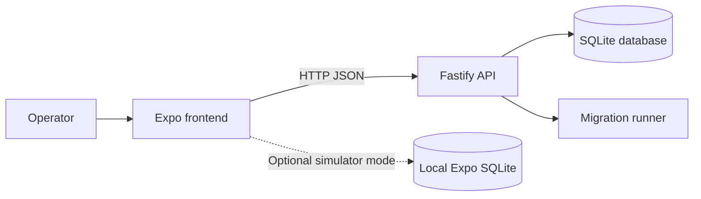

# TriFlow ER Triage

TriFlow is an emergency department dashboard for managing patient registration, triage, queues, treatment bays, staff assignments, inventory, and operational activity.

The project contains an Expo and React Native frontend, a Fastify and TypeScript API, and a SQLite database for local development and lightweight deployments.

## Features

- Patient registration and encounter history
- Emergency Severity Index triage and queue prioritization
- Treatment-bay availability and assignment
- Staff assignment, admission, and discharge workflows
- Resource and inventory management
- Dashboard metrics, event logs, notifications, and audit logs
- Role-aware access for registration, clinical, admin, and viewer users
- Responsive web interface for mobile, tablet, and desktop
- Automatic local administrator sign-in during development
- SQLite persistence with transactional workflows and migrations

## Application modules

| Module | Purpose |
| --- | --- |
| Dashboard | View patient totals, queue status, bay capacity, and recent activity |
| Inbox | Review encounters and record ESI triage assessments |
| Waiting Room | Monitor encounters waiting for treatment |
| Treatment Bays | Assign bays and staff, then admit or discharge encounters |
| Staff and Resources | Manage staff availability and resource inventory |
| Administration | Manage patients, treatment bays, staff, and resources |

## Technology stack

| Area | Technology |
| --- | --- |
| Frontend | Expo, React Native, Expo Router, TypeScript |
| Web | React Native Web, NativeWind |
| Backend | Fastify, TypeScript |
| Database | SQLite with Node's built-in `node:sqlite` driver |
| Testing | Node test runner, TypeScript checks, Expo lint, k6 |
| Runtime | Node.js 24.3+ or Node.js 26.x |

## Architecture

In shared mode, the frontend calls protected `/api/v1` endpoints. The API validates permissions and commits workflow changes in SQLite transactions. Connected clients use the same server-side database.



### Frontend

- `src/app` contains Expo Router screens.
- `src/api` contains the API client and domain services.
- `src/auth` manages the current operator and role-based access.
- `src/components` contains dashboard and management UI.
- `src/database` and `src/simulation` support the optional local simulator.

### Backend

- `server/src` contains Fastify routes, services, repositories, authentication, and migrations.
- `server/migrations` contains SQLite schema migrations.
- `server/data` contains the runtime SQLite database and is ignored by Git.
- `server/load` contains k6 load-test scenarios.

## Repository structure

```text
Patient-Flow/
├─ README.md
└─ Patient-Flow-ER-Triage/
   ├─ src/
   ├─ tests/
   ├─ server/
   │  ├─ src/
   │  ├─ migrations/
   │  ├─ tests/
   │  ├─ load/
   │  ├─ data/
   │  └─ package.json
   ├─ package.json
   └─ package-lock.json
```

## Installation and setup

### Prerequisites

Install the following before starting the project.

- Git
- Node.js 24.3 or later
- npm
- A web browser

SQLite is provided by Node.js. The default web setup uses port `3000` for the API and port `8081` for Expo.

### Clone the repository

```sh
git clone https://github.com/Felaeia/Patient-Flow.git
cd Patient-Flow
```

If the repository is already available locally, open a terminal in its root directory.

### Install dependencies

The frontend and backend have separate package manifests and lockfiles.

```sh
npm --prefix Patient-Flow-ER-Triage install
npm --prefix Patient-Flow-ER-Triage/server ci
```

Use `npm install` for the frontend and `npm ci` for the backend.

## Running the project

The backend and frontend run as separate processes during development.

### Start the backend

Open the first terminal in the repository root and run:

```sh
npm --prefix Patient-Flow-ER-Triage/server start
```

The API listens on `http://127.0.0.1:3000`, creates `Patient-Flow-ER-Triage/server/data/triflow.sqlite`, and applies migrations on startup.

Check that the API is ready at [http://127.0.0.1:3000/ready](http://127.0.0.1:3000/ready).

### Start the web application

Open a second terminal in the repository root and run:

```sh
npm --prefix Patient-Flow-ER-Triage run web
```

Open [http://localhost:8081](http://localhost:8081). The local web build connects to the API and signs in as the development administrator automatically.

Keep both terminals running while using the application. Press Ctrl+C in each terminal to stop the services.

### Run a native development build

Use the following commands from the repository root.

```sh
npm --prefix Patient-Flow-ER-Triage run android
npm --prefix Patient-Flow-ER-Triage run ios
```

The Android command requires the Android toolchain. The iOS command requires macOS and Xcode. Set `EXPO_PUBLIC_TRIFLOW_API_URL` to an API address reachable from the emulator or device before launching Expo.

## Usage

1. Create a treatment bay and staff member from the admin screens if the database is empty.
2. Register a fictional patient in **Patient Management**.
3. Open **Inbox** and record the patient's ESI assessment.
4. Select the waiting encounter and assign a treatment bay.
5. Open the encounter in **Treatment Bays** to assign staff, admit the patient, or discharge the patient.

## Configuration

### Backend environment variables

| Variable | Purpose | Default |
| --- | --- | --- |
| `SQLITE_PATH` | SQLite database file path | `server/data/triflow.sqlite` |
| `HOST` | API bind address | `127.0.0.1` |
| `PORT` | API port | `3000` |
| `CORS_ORIGINS` | Comma-separated allowed web origins | Local Expo origins |
| `DEV_TOKENS` | Additional development tokens and roles | None |
| `AUTH_ADAPTER` | Production ES module exporting `authenticate` | Required in production |
| `LEGACY_NOTIFICATION_RECIPIENT` | Actor for imported notifications | None |

Example PowerShell configuration:

```powershell
$env:SQLITE_PATH = "./data/triflow.sqlite"
$env:CORS_ORIGINS = "http://localhost:8081,http://127.0.0.1:8081"
npm --prefix Patient-Flow-ER-Triage/server start
```

Relative `SQLITE_PATH` values resolve from the directory where the API process starts.

### Frontend environment variables

| Variable | Purpose |
| --- | --- |
| `EXPO_PUBLIC_TRIFLOW_API_URL` | API base URL for a device or non-default server |
| `EXPO_PUBLIC_TRIFLOW_TOKEN` | Build-time credential for automatic sign-in |
| `EXPO_PUBLIC_TRIFLOW_ROLE` | Local simulator role such as `registration`, `clinical`, or `viewer` |
| `EXPO_PUBLIC_TRIFLOW_MODE` | Set to `local` to use the device-local simulator |
| `EXPO_PUBLIC_TRIFLOW_SEED` | Set to `1` to seed local simulator data once |

Restart Expo after changing frontend environment variables.

## Authentication and roles

Local development automatically uses the administrator credential `triflow-local-development-admin`.

For production, set `NODE_ENV=production` and provide an `AUTH_ADAPTER` that verifies the `Authorization: Bearer <token>` header and maps it to a stable actor ID and role. Use HTTPS, restrict CORS to trusted origins, protect the SQLite file, and configure backups, monitoring, and an identity provider before handling real patient data.

## Database and migrations

The API creates the SQLite database and runs migrations at startup. Run migrations explicitly from the repository root with the following command.

```sh
npm --prefix Patient-Flow-ER-Triage/server run migrate
```

SQLite uses WAL mode and foreign-key enforcement. Registration, triage, assignment, inventory, admission, and discharge workflows run in transactions.

To import a legacy simulator snapshot, use an empty destination database:

```powershell
$env:SQLITE_PATH = "./data/imported.sqlite"
$env:LEGACY_NOTIFICATION_RECIPIENT = "<recipient-actor-id>"
npm --prefix Patient-Flow-ER-Triage/server run migrate
npm --prefix Patient-Flow-ER-Triage/server run import:sqlite -- "C:\path\to\snapshot.db"
```

Review record counts, active assignments, inventory, and historical records after import. The importer does not provide offline synchronization.

## API reference

Health and documentation endpoints:

- `GET /health` reports process liveness.
- `GET /ready` checks database and migration readiness.
- `GET /openapi.json` returns the generated OpenAPI document.

Protected endpoints are under `/api/v1`. Successful responses use a `data` property. Errors include `status`, `code`, `message`, `requestId`, and optional validation details.

| Area | Main endpoints |
| --- | --- |
| Identity and dashboard | `GET /me`, `/dashboard`, `/events` |
| Patients | `GET/POST /patients`, `GET/PATCH /patients/{patientId}` |
| Encounters | `GET/POST /patients/{patientId}/encounters`, `GET /encounters/{encounterId}` |
| Clinical workflow | `POST /encounters/{id}/triage`, `/bay-assignment`, `/staff-assignments`, `/discharge` |
| Queues and bays | `GET /queues`, `PATCH /queues/{id}`, `GET/POST /treatment-bays` |
| Staff and inventory | `GET/POST /staff`, `GET/POST /resources`, resource adjustments |
| Notifications and audit | `GET /notifications`, notification read actions, `GET /audit-logs` |

See the [backend README](Patient-Flow-ER-Triage/server/README.md) for the complete route contract and load-test instructions.

## Testing and quality checks

Run backend checks from the repository root:

```sh
npm --prefix Patient-Flow-ER-Triage/server run check
npm --prefix Patient-Flow-ER-Triage/server test
```

Run frontend checks from the Expo project directory:

```sh
cd Patient-Flow-ER-Triage
npx tsc --noEmit
npm run lint
npm run test:database
npx expo export --platform web
```

The frontend database tests use a temporary SQLite file and cover migrations, foreign keys, patient records, assignments, notifications, seeding, and persistence. See the [backend load-testing guide](Patient-Flow-ER-Triage/server/README.md#verification-and-load) for k6 scenarios.

## Deployment

SQLite supports local development, demos, single-operator use, and lightweight single-instance deployments with persistent disk. Run one API instance, keep the database directory writable, and use SQLite-aware backups.

For multiple workstations, high write concurrency, or hospital production workloads, place the API behind an authenticated gateway and consider a managed relational database such as PostgreSQL. Keep the frontend connected through the API contract.

## Troubleshooting

### The app asks for an API URL

Start the backend first and confirm that [http://127.0.0.1:3000/ready](http://127.0.0.1:3000/ready) responds. For a custom API address, set `EXPO_PUBLIC_TRIFLOW_API_URL` and restart Expo.

### The app asks for bearer credentials

Use the local development server for automatic sign-in. For an exported build, provide `EXPO_PUBLIC_TRIFLOW_TOKEN` and configure the server's production `AUTH_ADAPTER`.

### CORS errors appear in the browser

Set `CORS_ORIGINS` to the exact origin in the browser address bar, including the port, then restart the API.

### Port 3000 is already in use

Choose another port and point Expo to it:

```powershell
$env:PORT = "3001"
npm --prefix Patient-Flow-ER-Triage/server start
```

In the Expo terminal:

```powershell
$env:EXPO_PUBLIC_TRIFLOW_API_URL = "http://127.0.0.1:3001"
npm --prefix Patient-Flow-ER-Triage run web
```

### The database is locked or unavailable

Ensure only the intended API process writes to the file, verify that its directory is writable, and use an online backup or clean shutdown before copying the database.

## Contributing

Open a [GitHub issue](https://github.com/Felaeia/Patient-Flow/issues) with reproduction steps for a bug or a description of a proposed change. Pull requests should describe the change and include the checks that passed. Use fictional patient data in examples and screenshots.
